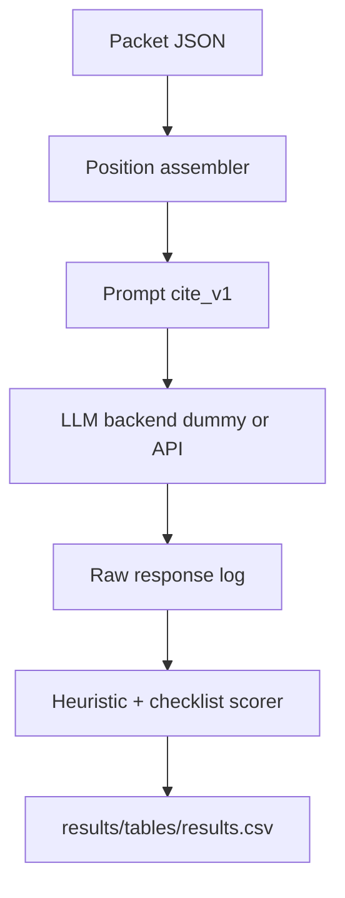

# Frozen evaluation protocol (Prompt 07 draft)

**Status:** Frozen for Gate G3 analysis (2026-11-13). Primary evidence run locked.  
**Approved direction:** Pathway B · position comparison (human-approved G1 2026-10-30; G3 deepen 2026-11-13)  
**Locked run:** `results/raw/run_20261030T142328Z` · model `openai/gpt-oss-20b`

## Input / output

| | Definition |
|---|---|
| Input item | `data/packets/*.json` with question, passages[], gold_evidence_ids, gold_answer_key, optional contradict_ids |
| Conditions | Same passages; gold evidence placed at **begin**, **middle**, or **end** among distractors |
| Model output | Free-text answer that must include citations like `[P2]` for passage ids |
| Scored outputs | CSV rows: item_id, position, backend, model, correctness, coverage, citation_support, raw_response_path |

## Architecture

## Controls

- Identical passage text across positions (only order changes).
- Single prompt template version `cite_v1`.
- Temperature 0.0; seed recorded (API may still be non-deterministic — log that).
- No train/test leakage: evaluation set is fully held-out hand-built items (no training).

## Metrics (higher is better unless noted)

1. **answer_correctness** ∈ {0,1}: matches gold_answer_key (substring / keyword rule documented per item).  
2. **evidence_coverage** ∈ [0,1]: fraction of `gold_evidence_ids` cited or clearly used.  
3. **citation_support** ∈ [0,1]: among citations produced, fraction that point to a gold supporting id (or correctly to contradict id when claiming conflict).  

## Deep analysis

Error cases: correct-looking answer with missing middle evidence; citation to distractor; missed contradiction.

## Pre-experiment / G3 checklist

- [x] Model name/version frozen in `configs/experiment.yaml`  
- [x] Packet set frozen for the primary reported run (`item_01`–`item_12`)  
- [x] Primary metrics: **citation_support**, then coverage; correctness secondary/heuristic  
- [x] Raw outputs compared with scores (see `baseline_audit_report.md`; the bold-citation miss was found by the assistant)  
- [x] G3 eval regenerated only from real CSV (`scripts/evaluate_results.py`)  

## Threats to validity

Small N; synthetic packets; heuristic scoring ≠ expert judgment; free-API instability; position confounded with local coherence (mitigate by fixed templates).